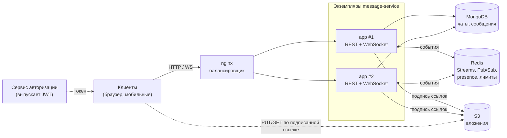
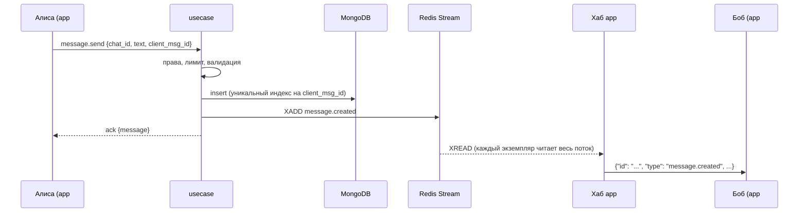

# Message Service

Сервис сообщений на Go: чаты, история, доставка в реальном времени по WebSocket.
Горизонтально масштабируется — несколько экземпляров за балансировщиком обмениваются
событиями через Redis, и клиенты на разных экземплярах видят сообщения друг друга.

**Стек:** Go 1.26 · Echo · MongoDB · Redis (Streams, Pub/Sub) · S3 · WebSocket · Prometheus · Grafana · Docker Compose · nginx

## Возможности

- **Чаты:** личные (один на пару пользователей) и групповые с ролями owner / admin / member,
  управление участниками, передача владения, список чатов с превью и счетчиком непрочитанных.
- **Сообщения:** курсорная пагинация, полнотекстовый поиск, правка, ответы, реакции, закрепы,
  мягкое удаление (в истории остается «надгробие»), модерация чужих сообщений админами.
- **Реальное время:** все изменения приходят событиями по WebSocket; typing, онлайн-статус
  с учетом нескольких устройств, отметки прочтения.
- **Надежная доставка:** идемпотентная отправка по `client_msg_id`, догрузка пропущенных
  событий после переподключения (`last_event_id`), честный `resync_required`, если догрузить нельзя.
- **Вложения:** клиент загружает файл напрямую в S3 по подписанной ссылке, сервис проверяет
  размер по хранилищу и принадлежность файла чату.
- **Защита:** JWT RS256 (сервис только проверяет токены), rate limit на пользователя для REST
  и отправки сообщений, проверка прав на каждую операцию.
- **Эксплуатация:** метрики Prometheus и дашборд Grafana, пробы `/healthz` и `/readyz`
  (при остановке readiness сразу отвечает «не готов» — оркестратор вроде Kubernetes успевает
  убрать экземпляр из балансировки), graceful shutdown, структурированные логи с request ID.

## Архитектура



**Как сообщение доходит до получателя.** Клиент отправляет `message.send` на любой экземпляр.
Usecase проверяет права и лимит, сохраняет сообщение в MongoDB и публикует событие в Redis Stream.
Каждый экземпляр читает поток целиком, определяет получателей (участников чата, состав кэшируется
в памяти) и раздает событие своим WebSocket-соединениям через Хаб.



### Решения и компромиссы

| Решение | Почему |
|---|---|
| ID - ULID | Сортируется по времени: один индекс `chat_id + _id` дает и порядок, и курсор пагинации. |
| Redis Streams для событий | В отличие от Pub/Sub, события сохраняются: клиент после обрыва догружает пропущенное по ID. Typing и presence идут через Pub/Sub — их хранить незачем. |
| Каждый экземпляр читает весь поток | Получатель может быть подключен к любому экземпляру. Consumer group разделила бы события между экземплярами, а нужно, чтобы каждое увидели все. |
| Без sticky sessions | Состояние соединений локально, но события общие — клиент может попасть на любой экземпляр. |
| Кэш участников в памяти | Проверка прав на каждое сообщение и рассылка не ходят в MongoDB. При изменении состава кэш сбрасывается событием на всех экземплярах, TTL — страховка. |
| Мягкое удаление | На удаленное сообщение могут ссылаться ответы и закрепы; клиенты видят «сообщение удалено» вместо дыры в истории. |
| Счетчик непрочитанных до 100 | `CountDocuments` с лимитом не сканирует всю историю чата; клиенту достаточно «99+». |
| Медленный клиент отключается | Хаб не ждет: если буфер соединения переполнен, соединение закрывается, клиент переподключается и догружает пропущенное. |
| Сбой Redis при rate limit — пропуск | Лимит защищает от злоупотреблений; лучше временно без него, чем отказ всем пользователям. |
| Файлы мимо сервиса | Загрузка и скачивание идут напрямую в S3 по подписанным ссылкам, сервис не держит файлы в памяти. |

## Быстрый старт

Нужны Docker и Go 1.26.

```bash
cp .env.example .env          # задайте пароли
go run ./cmd/devtoken         # создаст keys/ и выдаст токен
docker compose up -d --build  # 2 экземпляра сервиса за nginx, MongoDB, Redis, S3
```

Сервис доступен на `http://localhost:8080`:

| Адрес | Что там |
|---|---|
| http://localhost:8080 | Демо-клиент чата: вставьте токен и подключитесь |
| http://localhost:8080/docs | Swagger UI, спецификация — [openapi.yaml](internal/transport/http/static/openapi.yaml) |
| http://localhost:9001 | Консоль S3-хранилища |

Чтобы пообщаться в демо-клиенте, выпустите два токена и откройте две вкладки (вторую — в приватном окне):

```bash
go run ./cmd/devtoken   # пользователь 1
go run ./cmd/devtoken   # пользователь 2
```

### Мониторинг

```bash
docker compose --profile monitoring up -d
```

- Grafana: http://localhost:3000 — дашборд *Message Service* открывается без логина
- Prometheus: http://localhost:9090

Метрики (`/metrics`) и пробы здоровья (`/healthz`, `/readyz`) отдаются на отдельном порту `8081`,
который не публикуется через балансировщик.

### Авторизация

Регистрацией и логином занимается отдельный сервис. Этот сервис только проверяет access-токен:

- подпись RS256, нужен только публичный ключ (`JWT_PUBLIC_KEY_PATH`);
- `sub` — ID пользователя в формате ULID;
- `exp` обязателен.

Для локальной разработки его роль играет [`cmd/devtoken`](cmd/devtoken/main.go).

## API

Полное описание — в Swagger UI (`/docs`). Кратко:

| Метод | Путь | |
|---|---|---|
| `POST` | `/api/v1/chats` | создать личный или групповой чат |
| `GET` | `/api/v1/chats` | мои чаты с превью и непрочитанными |
| `GET` `PATCH` | `/api/v1/chats/{id}` | чат / переименовать |
| `POST` `DELETE` | `/api/v1/chats/{id}/members[/{user_id}]` | участники |
| `PUT` | `/api/v1/chats/{id}/members/{user_id}/role` | роль, передача владения |
| `POST` | `/api/v1/chats/{id}/read` | отметка прочтения |
| `GET` | `/api/v1/chats/{id}/presence` | кто онлайн |
| `GET` `PUT` `DELETE` | `/api/v1/chats/{id}/pins[/{message_id}]` | закрепы |
| `POST` `GET` | `/api/v1/chats/{id}/attachments` | ссылки на загрузку и скачивание |
| `POST` `GET` `DELETE` | `/api/v1/messages` | отправить, история, удалить |
| `PUT` | `/api/v1/messages/{id}` | изменить |
| `PUT` `DELETE` | `/api/v1/messages/{id}/reactions` | реакции |
| `GET` | `/api/v1/messages/search` | полнотекстовый поиск |
| `GET` | `/api/v1/ws` | WebSocket |

### WebSocket

```
GET /api/v1/ws?token=<jwt>&last_event_id=<id последнего полученного события>
```

```jsonc
// клиент -> сервер
{"type": "message.send", "ref": "1", "payload": {"chat_id": "...", "text": "привет", "client_msg_id": "..."}}
{"type": "typing", "payload": {"chat_id": "..."}}
{"type": "chat.read", "ref": "2", "payload": {"chat_id": "...", "message_id": "..."}}

// сервер -> клиент
{"type": "connected", "payload": {"user_id": "...", "instance": "...", "last_event_id": "...", "resync_required": false}}
{"type": "ack", "ref": "1", "payload": {...сообщение...}}
{"type": "error", "ref": "1", "payload": {"code": "FORBIDDEN", "message": "..."}}
{"id": "1731340000000-0", "type": "message.created", "chat_id": "...", "payload": {...}}
```

Пропущенные за время обрыва события приходят до кадра `connected`. Событие может прийти дважды —
клиент отбрасывает дубликаты по `id`.

## Разработка

```bash
make test               # unit- и e2e-тесты с -race
make test-integration   # репозитории и шина событий против настоящих MongoDB и Redis (testcontainers)
make lint               # golangci-lint
```

**Тесты:**

- **e2e** ([internal/app](internal/app)) — настоящие HTTP-сервер, WebSocket, Хаб, все usecase,
  шина событий, presence и rate limit на Redis (miniredis); подменены только MongoDB и S3.
- **unit** — правила прав доступа, отправка и модерация сообщений, вложения, Хаб под `-race`,
  догрузка событий, rate limit, presence, проверка JWT.
- **integration** (`-tags integration`) — запросы к MongoDB (индексы, `$text`, `$max`,
  array filters) и обрезка Redis Stream на настоящих серверах.

CI ([.github/workflows/ci.yml](.github/workflows/ci.yml)): линтер, тесты с `-race`,
интеграционные тесты, сборка Docker-образа.

### Структура

```
cmd/
  app/                  точка входа, сборка зависимостей, graceful shutdown
  devtoken/             заглушка сервиса авторизации для разработки
internal/
  app/                  HTTP-сервер, маршруты, служебный сервер (метрики, пробы)
  domain/               сущности и доменные ошибки
  usecase/              бизнес-логика: чаты, сообщения, presence, вложения
  database/mongo/       репозитории MongoDB
  broker/redis_events/  шина событий: Redis Streams и Pub/Sub, догрузка
  ws/                   Хаб и WebSocket-соединения
  transport/            HTTP-хендлеры, middleware, OpenAPI и демо-клиент
  presence/ ratelimit/ storage/s3/ cache/ metrics/
deploy/                 nginx, Prometheus, Grafana
```

### Конфигурация

Переменные окружения (полный список — [.env.example](.env.example)), остальное — [config/config.yaml](config/config.yaml).

| Переменная | По умолчанию | |
|---|---|---|
| `SERVER_PORT` / `ADMIN_PORT` | `8080` / `8081` | API и служебный порт |
| `MONGO_URI`, `MONGO_DATABASE` | — | MongoDB |
| `REDIS_ADDR`, `REDIS_PASSWORD` | `localhost:6379` | Redis |
| `JWT_PUBLIC_KEY_PATH` | `keys/jwt_public.pem` | публичный ключ сервиса авторизации |
| `S3_ENDPOINT` | — | без него вложения отключены |
| `S3_PUBLIC_ENDPOINT` | `S3_ENDPOINT` | адрес S3 для клиентов, если отличается от внутреннего |
| `APP_REPLICAS` | `2` | сколько экземпляров поднимает compose |
